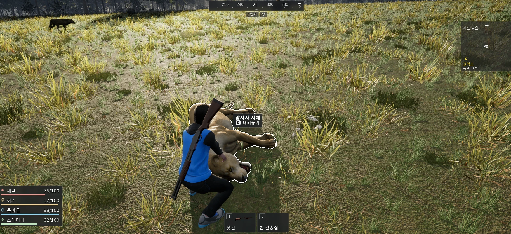
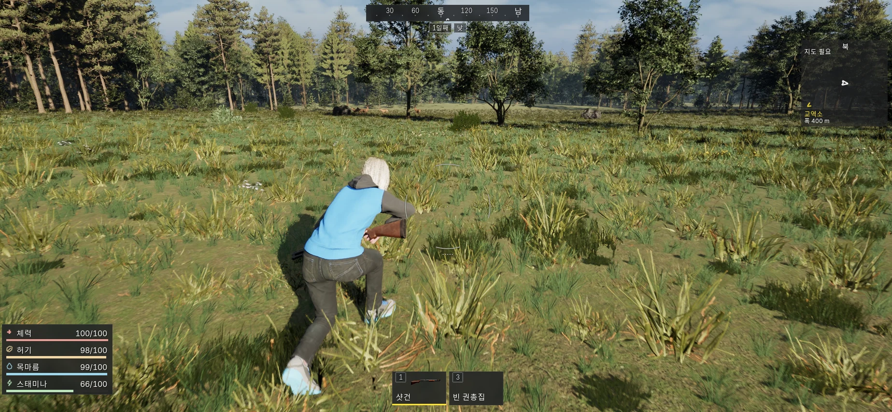
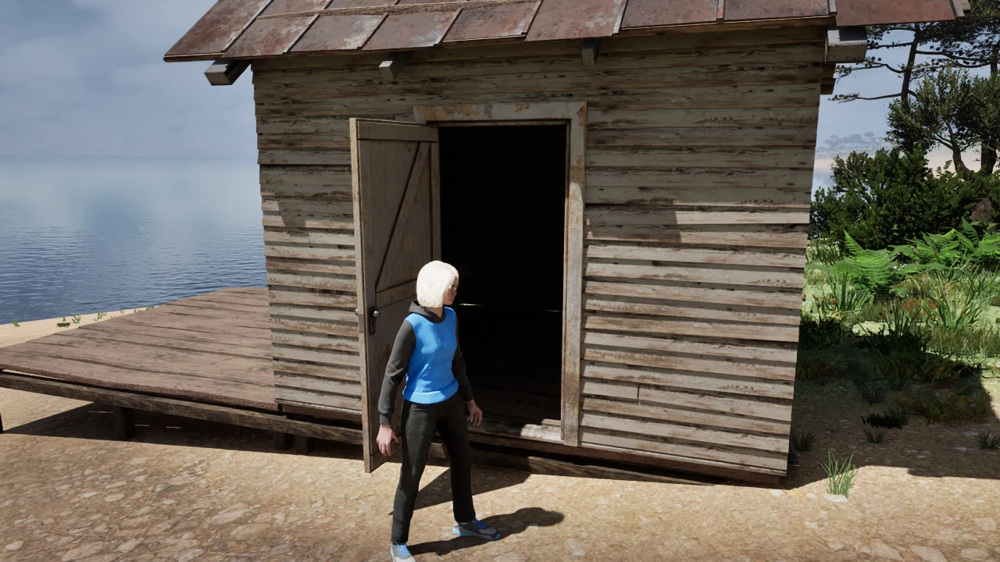

# NONGJANG : 농장

TEAM NIRIZ, 고정선(메샤미) 1인 개발, Unreal Engine 5.7.4 / C++, 개발 중

외딴섬에서 동물을 관찰하고 사냥과 채집으로 자원을 모아 집을 지으며 살아가는 3인칭 생태계 생존 게임입니다. 동물의 감각, 욕구, 위험 기억과 플레이어에 대한 관계를 행동 판단에 연결하고 화면 밖 개체의 상태도 저장해 다시 만났을 때 이어지도록 만들고 있습니다.

생존, 제작, 건축, 사냥, 동물 교감, 차량, 저장을 연결한 개발본을 바탕으로 캐릭터 동작과 생활 흐름을 다듬고 있습니다. 본편은 교역소를 통한 최대 2인 섬 방문을 개발합니다. 공개 데모는 싱글 플레이로 준비하며 아직 공개 다운로드를 제공하지 않습니다.

[웹 포트폴리오](https://teamniriz.com/portfoliosecret#nongjang), [TEAM NIRIZ 게임 소개](https://teamniriz.com/#nongjang), [Discord](https://discord.gg/uXfjXmnd68)

## 실제 개발 화면

2026-10-21 개발 화면. 사냥 이후의 운반 상호작용과 체력, 허기, 목마름, 스태미나, 장비 슬롯을 함께 볼 수 있습니다.

2026-10-21 개발 화면. 숲과 초원 사이에서 사슴 무리를 관찰하는 장면입니다. 정지 화면은 전 종의 행동이나 장기 생태 검수 결과를 대신하지 않습니다.

2026-10-07 개발 화면. 직접 짓는 오두막과 정착 공간입니다. 이미지 출처와 촬영 시점은 [미디어 안내](media/README.md)에 기록했습니다.

## 최근 개발 현황

문서 기준일: **2026-11-02**. 현재 소스와 10월~11월 구현, 검수 기록을 대조했습니다. 이 문서를 갱신하면서 게임이나 검사를 새로 실행하지는 않았습니다.

| 영역 | 구현, 확인한 내용 | 이어서 확인할 범위 |
|---|---|---|
| 생존, 건축, 새 생명 | 제작과 설치, 통나무 집, 가구, 램프, 울타리, 침대 수면과 사망 후 새 생명 흐름의 개발 검수 기록 | 실제 섬의 시작부터 정착, 사망, 복원까지 연속 플레이 |
| 동물 AI와 교감 | 감각, 욕구, 위험 기억, 먹이, 쓰다듬기, 명령, 원거리 개체 전환과 관계 저장 | 전 종의 행동, 교감, 사육, 장기 개체군과 자원 균형 |
| 무기와 캐릭터 | 파지, 보행, 장전, 꺼내기, 집어넣기와 관통 문제를 실제 표시 캐릭터로 수정, 검수 | 권총과 다른 체형, 착장, 자세, 네트워크와 최종 품질 |
| 차량과 운반 | 수리, 주행, HUD, 트렁크, 사체 적재 경로, 승하차 뒤 발 재디딤과 일반 자세 복귀 후보 검수 | 전체 승하차, 좌석 접촉, 다른 체형, 실제 월드, 후보의 기본 게임 적용 |
| 저장과 방문 | 두 저장 세대, 방문, 귀환 기록과 물품 소유권, 같은 PC 독립 프로세스의 LAN 시나리오 | 저장 중 강제 종료, 손상 복구, 실제 두 PC, Steam 두 계정 |
| 데모 | 싱글, 게임 속 생존 3일, 새 게임마다 재체험으로 정책 변경 | 현재 구형 시간 제한 코드를 새 정책으로 전환하고 패키지에서 검수 |

11월 1일 매그넘 검수는 특정 여성 캐릭터, 후디, 독립 실행 조건에서 실제 장비 제작, 장착, 꺼내기, 조준, 장전, 집어넣기 흐름을 확인한 기록입니다. 다른 캐릭터나 멀티플레이까지 완료했다는 뜻은 아닙니다. [최신 개발 기록](docs/update-2026-11.md)에 범위와 남은 문제를 정리했습니다.

## 직접 맡은 일과 개발 방식

고정선이 게임 기획과 요구사항, 기능 우선순위, 통합과 검수 판단을 맡고 Codex와 Claude를 함께 사용해 C++ 구현, 에셋 연결, 자동 검사와 실제 화면 검수 도구를 작업합니다. 실패한 후보와 채택한 변경을 구분하고 실제로 확인한 조건을 기록합니다.

동물의 적응 행동은 규칙 기반 경험 기억입니다. 피격 대상과 위치를 기록하고 시간이 지나면 위험도를 줄여 다음 행동에 반영합니다. 캐릭터, 동물, 환경에는 외부 에셋을 활용하며 게임 시스템 개발과 자산 제작의 기여를 구분합니다. 원본 게임 코드와 상용 에셋, 개인 저장, 인증 정보는 이 저장소에 포함하지 않습니다.

## 문서

1. [11월 개발 기록](docs/update-2026-11.md) — 최근 구현과 실제 검수 범위
2. [전체 구조](docs/architecture.md) — 행동 판단, 애니메이션, 저장, 네트워크
3. [동물 AI와 교감](docs/animal-ai.md) — 전투 단계, 기억, 관계, 명령
4. [원거리 생태와 저장](docs/ecology-and-persistence.md) — 개체 전환, 자원, 복원
5. [개발 방식과 검증](docs/development-and-validation.md) — 날짜별 검사와 조건
6. [남은 작업](docs/roadmap.md), [데모와 출시 계획](docs/release-plan.md)

기존 목표는 2027년 1~2월 공개 데모, 2027년 3월 Steam 얼리 액세스입니다. 확정 출시일은 아니며 통합, 배포 검수 결과에 따라 다시 판단합니다. 정식 1.0 일정은 미정입니다.
